<h1 align="center">Hey, I'm Ethan</h1>

  <b>Mechatronics Engineering Student @ Western University</b>
   
  <b>Software Team Lead @ <a href="https://github.com/UWO-Aero-Design">Western Aero Design</a></b>

 

- I enjoy working on anything related to embedded systems, firmware, robotics or aviation
- I use AI in my workflow. I find that it's actually best at multiplying my productivity, instead of completely automating things
- My skills are C/C++, Rust, Python, ARM processors, RTOS, Embedded Linux Environments, and Claude.ai

 

  
   
  <a href="https://<your-username>.github.io/iss-captcha/">
    
  </a>

